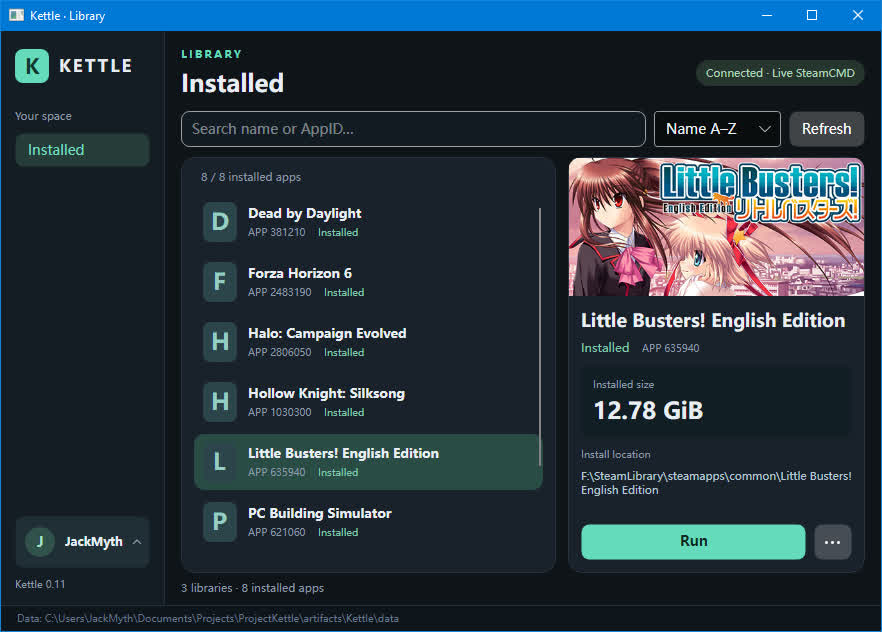

# Kettle

[English](README.md) | [中文](README.zh.md)

Kettle is a lightweight Steam game launcher with low memory usage. It uses SteamCMD to sign in to your account and run installed games you own, without keeping the full Steam client running.

Browse, search, and launch installed games, sync cloud saves for supported games, and keep achievements and playtime tracking working. Requires 64-bit Windows 10 version 1809 or later.

  

## Getting started

1. Set up SteamCMD and extract Kettle to a writable directory.
2. Launch `Kettle.exe`. By default, Kettle looks for `steamcmd.exe` in the parent of its own directory. If SteamCMD is elsewhere, specify its path:

   ```powershell
   .\Kettle.exe --steamcmd "D:\SteamCMD\steamcmd.exe"
   ```

3. Wait for startup preparation to finish, sign in to your Steam account, and complete verification as prompted.
4. Open **Settings** from the account menu in the bottom-left corner, then click **Add library**. Add the official Steam installation directory and any other Steam library directories that contain your games. Sign in again for these changes to take effect.
5. Select a game from the installed list and click **Run**. After the game exits, wait for save synchronization to finish before closing Kettle.

The interface follows your system language by default: both Simplified and Traditional Chinese systems use Simplified Chinese; all other languages use English. You can choose a language in **Settings → Language**. Restart Kettle to apply the change.

To build from source, install the .NET 10 SDK, Visual Studio C++ desktop build tools, and the Windows SDK, then run `./Build-Release.ps1` from the project root. The output is in `artifacts/Kettle-Release`.

## Important notes

- **You must also download and install the official Steam client** to download, install, and update games. Kettle only launches games and does not provide these operations.
- **You must add the official Steam installation directory to Kettle's library list.** Otherwise, games may fail to launch because shared runtime components are missing. Select the directory containing `steamapps`, rather than the `steam.exe` file.
- When a game needs an update, the Run button is disabled and shows **Update required**. Exit Kettle, update the game in the official Steam client, then reopen Kettle.
- If a save conflict or synchronization failure occurs, follow the prompts before continuing. Do not force-close the application during synchronization. Keep separate backups of important saves.
- Before launch, Kettle never uploads or deletes cloud files: cloud-only files are downloaded, and differing local/cloud copies require a conflict decision. After confirmed game exit, changed and new files are uploaded. Only files present at this launch and missing after exit qualify for cloud deletion, after backup and cloud-version checks. Historical saves missing on both sides before launch block the game until restored from backup.
- Settings, save backups, and recovery records are stored in the `data` folder inside Kettle's directory. Preserve this folder when upgrading or moving Kettle, and finish any pending synchronization first.
